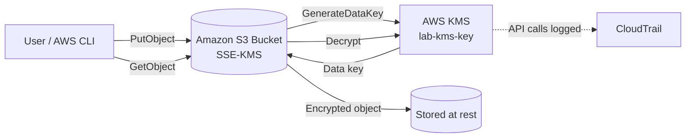
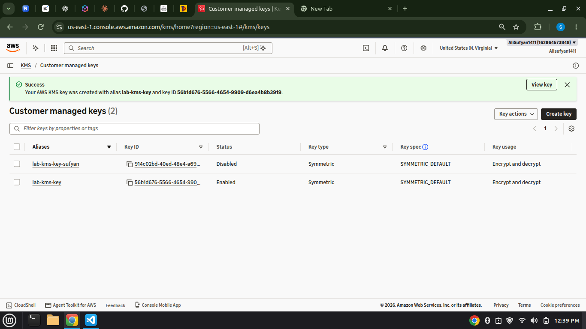
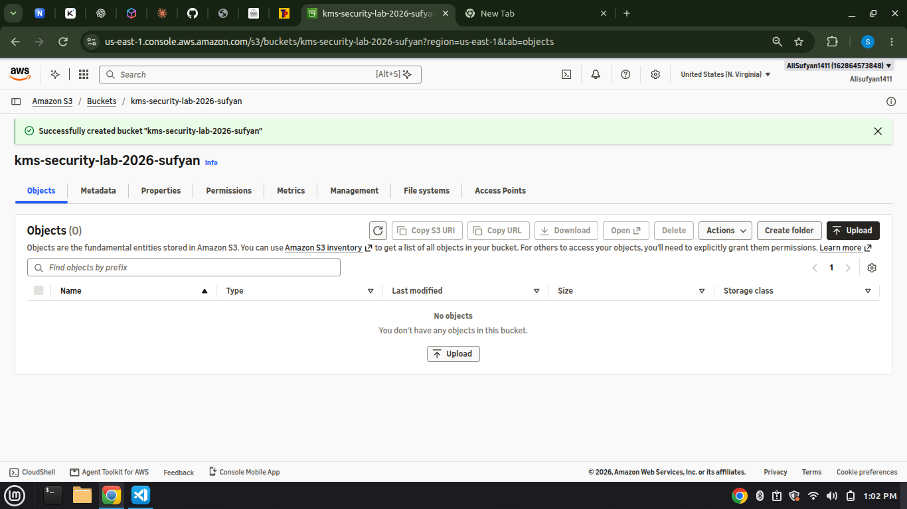
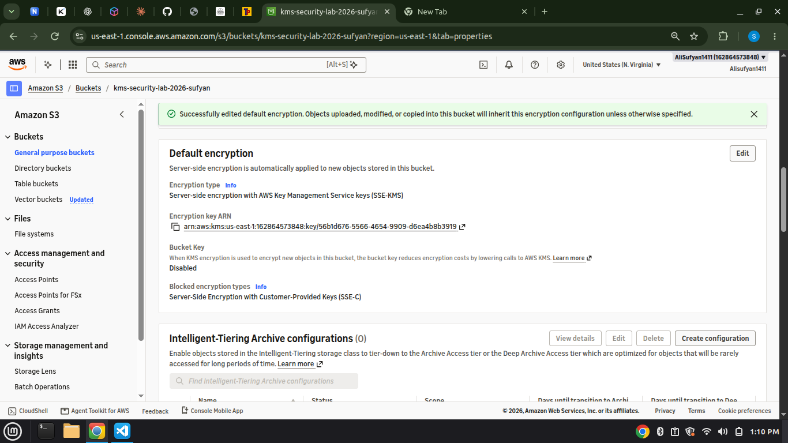
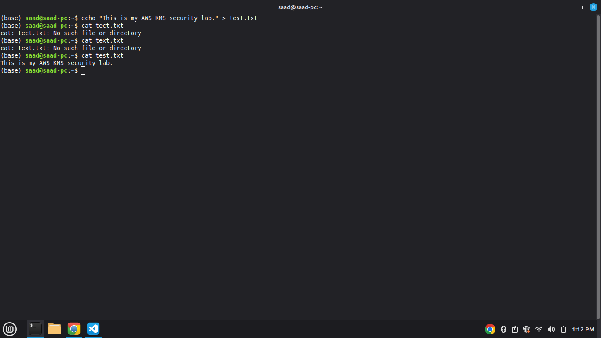
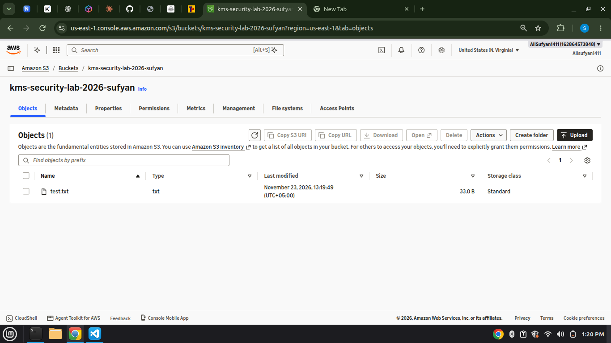
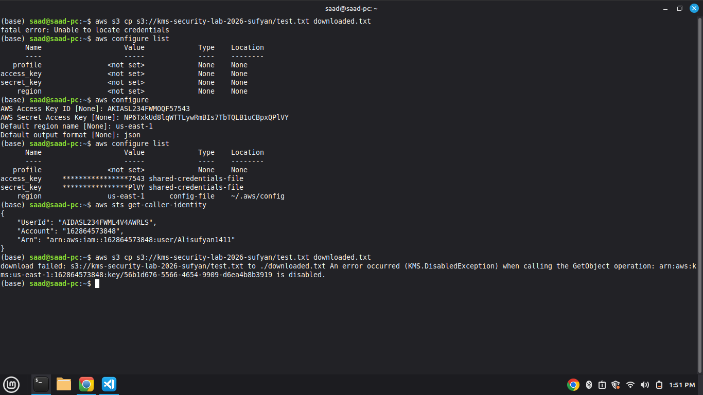
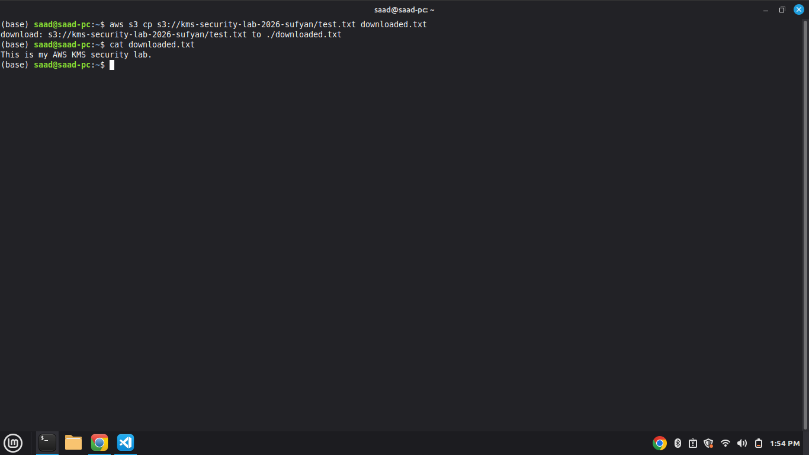
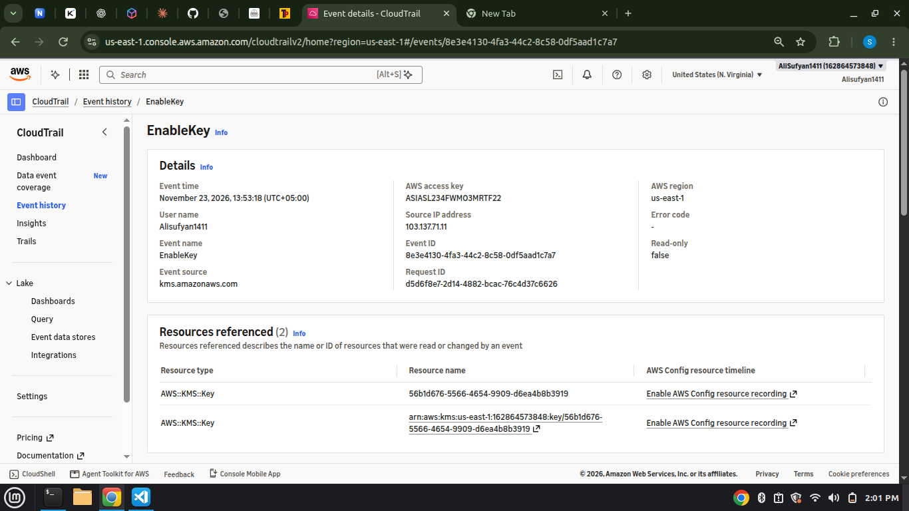
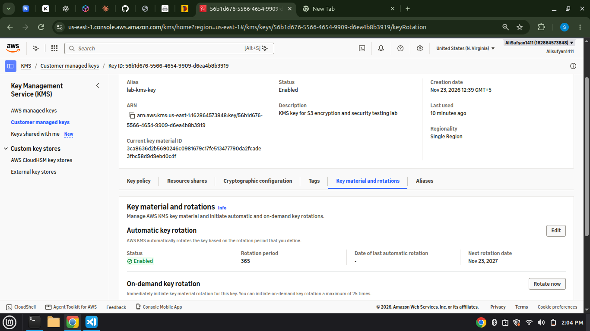

# AWS KMS Security Lab: S3 Encryption, Key Failure, Recovery and Auditing

A hands-on security lab where I created a **Customer Managed KMS key**, used it to encrypt an **Amazon S3** bucket (SSE-KMS), deliberately **disabled the key** to cause an outage, **recovered access**, and then **investigated the activity with CloudTrail**.


---

## Table of Contents

- [What is AWS KMS?](#what-is-aws-kms)
- [Key Concepts](#key-concepts)
- [Benefits](#benefits)
- [Lab Objectives](#lab-objectives)
- [Lab Overview](#lab-overview)
- [How It Works](#how-it-works)
- [Step-by-Step Guide](#step-by-step-guide)
- [Key Rotation vs Disable vs Deletion](#key-rotation-vs-disable-vs-deletion)
- [Troubleshooting](#troubleshooting)
- [Security Takeaways](#security-takeaways)
- [Clean Up](#clean-up)
- [What I Learned](#what-i-learned)
- [Author](#author)

---

## What is AWS KMS?

**AWS Key Management Service (KMS)** is a managed service for creating and controlling the cryptographic keys used to protect your data. KMS keys are stored in hardware security modules (HSMs) validated under FIPS 140 and never leave KMS in plaintext. Other AWS services such as S3, EBS, RDS, and Lambda call KMS to encrypt and decrypt data on your behalf.

With KMS you decide **who can use a key**, **what they can do with it**, and you get a full **audit trail** of every use through AWS CloudTrail.

---

## Key Concepts

| Concept | Meaning |
|---|---|
| **KMS key (CMK)** | The logical key used to encrypt and decrypt data. A *customer managed key* is one you create and control |
| **Symmetric key** | One key is used for both encryption and decryption (the default and most common type) |
| **Alias** | A friendly name for a key, e.g. `lab-kms-key` |
| **Key policy** | The main resource policy that controls who can administer and use the key |
| **Key administrator** | Can manage the key (edit policy, enable/disable, schedule deletion) but is not automatically able to use it for encryption |
| **Key user** | Can use the key for cryptographic operations (encrypt, decrypt, generate data keys) |
| **SSE-KMS** | Server-side encryption in S3 where the encryption keys are protected by KMS |
| **Data key** | A short-lived key generated by KMS to encrypt the actual object data (envelope encryption) |
| **CloudTrail** | The service that records KMS API calls for auditing |

---

## Benefits

- **Centralized key control**: one place to manage keys across many AWS services
- **Fine-grained access**: separate administrator and user roles through key policies and IAM
- **Full audit trail**: every `Decrypt`, `GenerateDataKey`, `DisableKey` call is logged in CloudTrail
- **Instant kill switch**: disabling a key immediately blocks decryption of data that depends on it
- **Automatic rotation**: key material can be rotated without changing your applications
- **Compliance-friendly**: supports requirements such as PCI DSS, HIPAA, and ISO 27001
- **Integrated**: works natively with S3, EBS, RDS, DynamoDB, Lambda, Secrets Manager, and more

---

## Lab Objectives

- Understand what AWS KMS is and how it works
- Create a Customer Managed Key (CMK)
- Configure Amazon S3 default encryption with SSE-KMS
- Verify encryption at rest
- See what happens when a KMS key is disabled
- Restore access to encrypted data
- Audit KMS activity using CloudTrail
- Understand key rotation, disabling, and deletion risks

---

## Lab Overview

| Setting | Value |
|---|---|
| Services | AWS KMS, Amazon S3, AWS CloudTrail, IAM |
| Tools | AWS Console, AWS CLI, Linux terminal (Kali) |
| Key type | Symmetric |
| Key usage | Encrypt and decrypt |
| Regionality | Single-Region |
| Key material origin | AWS KMS |
| Key alias | `lab-kms-key` |
| Bucket | `kms-security-lab-2026-sufyan` |
| S3 Bucket Key | Disabled (so every request calls KMS and shows in CloudTrail) |
| Level | Beginner |

---

## How It Works



S3 handles the encryption of the object, while KMS protects and controls the key. If KMS refuses to use the key (for example, because it is disabled), S3 cannot decrypt the object, even if the user has permission to read it.

---

## Step-by-Step Guide

> Replace `YOUR-BUCKET-NAME` with your real bucket name in every command below.

### Phase 1: Create a Customer Managed KMS Key

1. Open the AWS Console, search for **KMS**, and open **Key Management Service**.
2. Go to **Customer managed keys** → **Create key**.
3. Choose:
   - Key type: **Symmetric**
   - Key usage: **Encrypt and decrypt**
   - Regionality: **Single-Region**
   - Key material origin: **AWS KMS**
4. Set the alias to `lab-kms-key` and add the description `KMS key for S3 encryption and security testing lab`.
5. Add optional tags: `Environment = Lab`, `Project = KMS-S3-Lab`.
6. Select your IAM user as **Key Administrator**.
7. Select your IAM user as **Key User**.
8. Review and click **Finish**.

**Screenshot: key created and enabled**



---

### Phase 2: Create an S3 Bucket

1. Open **Amazon S3** → **Create bucket**.
2. Enter a globally unique name, e.g. `kms-security-lab-2026-xyz` (add random digits if taken).
3. Select the **same Region** as your KMS key.
4. Keep **Block all public access** enabled.
5. Leave other settings at default and click **Create bucket**.

**Screenshot: bucket created**



---

### Phase 3: Configure Default Encryption (SSE-KMS)

1. Open the bucket → **Properties** → **Default encryption** → **Edit**.
2. Set:
   - Encryption type: **Server-side encryption with AWS KMS keys (SSE-KMS)**
   - AWS KMS key: **Choose from your AWS KMS keys** → `lab-kms-key`
   - Bucket Key: **Disable**
3. Click **Save changes**.

**Screenshot: default encryption configured**



---

### Phase 4: Upload a File and Verify Encryption

Create a test file:

```bash
echo "This is my AWS KMS security lab." > test.txt
cat test.txt
```

**Screenshot: test file created**



Upload it through the console (**Objects** → **Upload** → **Add files** → `test.txt` → **Upload**), or with the CLI:

```bash
aws s3 cp test.txt s3://YOUR-BUCKET-NAME/test.txt
```

Verify the encryption: open the object → **Properties** → **Server-side encryption settings**. It should show **AWS KMS** with your `lab-kms-key`.

**Screenshot: file uploaded**



---

### Phase 5: Test KMS Key Behavior

**Step 11: Download the file while the key is enabled**

```bash
aws s3 cp s3://YOUR-BUCKET-NAME/test.txt .
cat test.txt
```

Expected output:

```
This is my AWS KMS security lab.
```

**Step 12: Disable the KMS key**

KMS Console → **Customer managed keys** → `lab-kms-key` → **Key actions** → **Disable**. The status changes to **Disabled**.

> Disabling does **not** delete the key or the S3 object. It only blocks cryptographic operations.

**Step 13: Try to download again**

```bash
aws s3 cp s3://YOUR-BUCKET-NAME/test.txt ./download2.txt
```

The download **fails** with an error like this:

```
download failed: s3://YOUR-BUCKET-NAME/test.txt to ./downloaded.txt An error occurred (KMS.DisabledException) when calling the GetObject operation: arn:aws:kms:us-east-1:<ACCOUNT-ID>:key/<KEY-ID> is disabled.
```

| Layer | Status |
|---|---|
| S3 permission | User may still be allowed to read the object |
| KMS decryption | Not available, the key is disabled |
| Result | S3 cannot decrypt, so the download fails |

**Screenshot: download failure**



---

### Phase 6: Recover Access

**Step 14: Re-enable the key**

KMS Console → `lab-kms-key` → **Key actions** → **Enable**. Wait until the status shows **Enabled**.

**Step 15: Download again**

```bash
aws s3 cp s3://YOUR-BUCKET-NAME/test.txt ./recovered.txt
cat recovered.txt
```

Expected output:

```
This is my AWS KMS security lab.
```

Access was restored **without re-uploading or re-encrypting** the object.

**Screenshot: recovery successful**



---

### Phase 7: Investigate KMS Activity with CloudTrail

1. Open **CloudTrail** → **Event history**.
2. Set the date range to **today**.
3. Filter by **Event source**: `kms.amazonaws.com`.

Events to look for:

| Event name | Meaning |
|---|---|
| `GenerateDataKey` | A data key was generated (object upload) |
| `Decrypt` | A decryption was requested (object download) |
| `DisableKey` | The KMS key was disabled |
| `EnableKey` | The KMS key was enabled |
| `DescribeKey` | Information about the key was requested |

**Inspect an event** (click `Decrypt`, `GenerateDataKey`, `DisableKey`, or `EnableKey`) and review: `eventName`, `eventTime`, `userIdentity`, `awsRegion`, `resources`, `requestParameters`, and `errorCode` (if the request failed).

**Screenshot: `EnableKey` event in CloudTrail**



**Security investigation questions**

1. Which IAM identity initiated the event?
2. What operation was performed?
3. Which KMS key was involved?
4. Did the operation succeed?
5. Could this operation be suspicious if you did not perform it?

> S3 `PutObject` and `GetObject` are data events and do not appear in default Event History unless S3 data events are enabled on a trail. This lab focuses on KMS API events.

---

### Phase 8: Key Rotation

1. Open KMS → select `lab-kms-key`.
2. Find the **Key rotation** section.
3. Review the rotation status and enable automatic rotation if available.

**Screenshot: automatic rotation enabled (365 days)**



---

### Phase 9: Key Deletion Safety

1. Open the key → **Key actions** → **Schedule key deletion**.
2. Review the process and the minimum **waiting period** (7 days).
3. **Do not schedule deletion** for this lab. If you do, cancel it immediately.

> Deleting a KMS key is **not** like deleting a file. If the key protecting your S3 objects is permanently deleted, the objects still exist but can never be decrypted.

---

## Key Rotation vs Disable vs Deletion

| Action | Effect |
|---|---|
| **Rotate key** | Refreshes key material while the logical key keeps working |
| **Disable key** | Temporarily blocks cryptographic operations (reversible) |
| **Enable key** | Restores cryptographic use of the key |
| **Schedule deletion** | Starts a waiting period before permanent destruction (data becomes unrecoverable) |

---

## Troubleshooting

| Problem | Likely cause | Fix |
|---|---|---|
| `Unable to locate credentials` | AWS CLI not configured | Run `aws configure` |
| `AccessDenied` on upload | IAM user is not a key user or lacks `kms:GenerateDataKey` | Add the user as a key user or fix the key policy |
| Bucket name already exists | Bucket names are globally unique | Add random digits to the name |
| Download fails after disabling | KMS key is disabled | Enable the key in KMS |
| KMS events missing in CloudTrail | Wrong date range or region | Check the date range and use the same Region as the key |

---

## Security Takeaways

- Encryption at rest is only as strong as the control you have over the key
- Disabling or deleting a key can cause an outage across every service that depends on it
- Separate **key administrators** from **key users** to follow least privilege
- Monitor `DisableKey`, `ScheduleKeyDeletion`, and unusual `Decrypt` calls in CloudTrail
- Keep a deletion waiting period and never schedule deletion casually

---

## Clean Up

1. Open S3 → your lab bucket.
2. Delete `test.txt` and any other uploaded files.
3. Delete the empty bucket.
4. Decide whether to keep the KMS key for future labs. A customer managed key costs about **$1 per month**, but do **not** schedule deletion just to save money.

```bash
aws s3 rm s3://YOUR-BUCKET-NAME/test.txt
aws s3 rb s3://YOUR-BUCKET-NAME
```

---

## What I Learned

- How KMS and S3 work together through SSE-KMS and envelope encryption
- The difference between key administrators and key users
- How disabling a KMS key blocks access to encrypted data even when S3 permissions are correct
- How to recover from a key outage by re-enabling the key
- How to trace KMS actions in CloudTrail for security investigation
- Why key deletion is dangerous and how rotation works

---

## Author

**Sufyan Ali**
Cloud Computing / AWS Cloud Security student

- GitHub: [your-username](https://github.com/your-username)
- LinkedIn: [your-profile](https://www.linkedin.com/in/your-profile)

---

*If you found this helpful, give the repo a star.*
